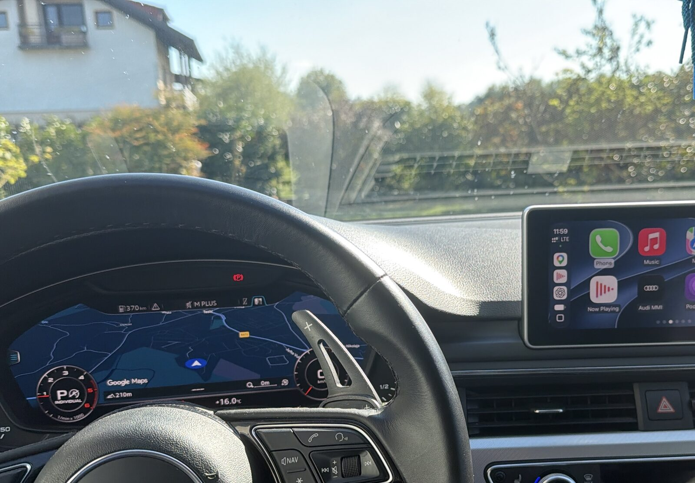
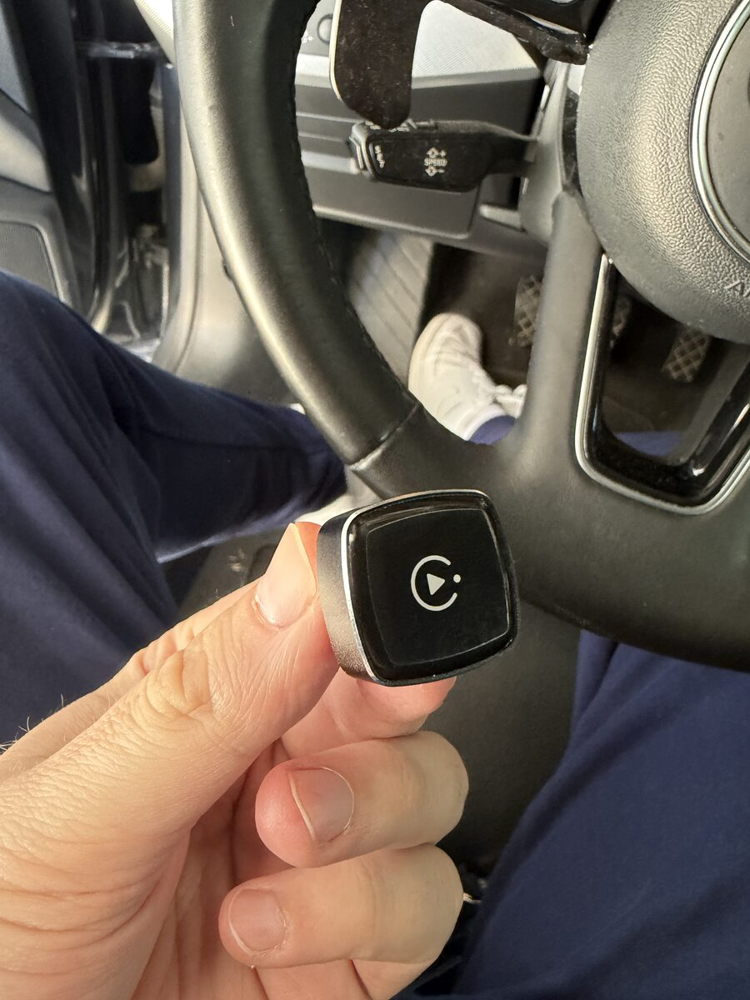

# Wireless CarPlay on the Audi Virtual Cockpit

**CarPlay maps (Google Maps / Apple Maps) on the Audi Virtual Cockpit over a *wireless* CarPlay dongle.**

Before this, the CarPlay map on the Virtual Cockpit (VC) only worked with a USB cable. With a wireless dongle you got CarPlay on the center screen, but the VC stayed on Audi's own map. This repo contains a small firmware add-on for one specific dongle that fixes that. The map shows on the VC, the picture is as sharp as it is over a cable, and the steering-wheel scroll wheel zooms in and out.

> ✅ Tested in the car on 2026-10-19: Google Maps on the VC, wireless, zoom with the wheel works.



https://github.com/user-attachments/assets/9a17e6ca-0180-4f53-975d-7e01604c9c29



---

## Will this work for me?

You need **all three**:

### 1. The car: Audi MHI2Q with cluster CarPlay already working over cable

- Head unit: **MHI2Q** (Harman). In the dongle's info page the car shows up as manufacturer `HARMAN`, model `AUDI 4930`.
- The car must already have the **MIBSI CarPlay-in-Virtual-Cockpit mod** installed, and **the map must already appear on the VC when you plug the iPhone in with a cable**.
  - Package I used (got it from a Facebook group): [`car/mibsi-p5092-…-sd-bundle.zip`](car/). It contains `install.zip` and `uninstall.zip` plus a README.
  - **It only installs on MMI firmware `MHI2Q_ER_AUG22_P5092_MU1329`.** The installer refuses any other firmware. Check your version in the MMI (red engineering menu / software version).
  - Install: unzip `install.zip` to the root of an empty FAT32 SD card, open the red update menu → Update → SD card → Standard, and wait until it finishes. `uninstall.zip` restores the backup the same way.
  - Related open-source project: [yuedizhibo/MHI2Q-CarPlay-AltScreen](https://github.com/yuedizhibo/MHI2Q-CarPlay-AltScreen)
- My car: **Audi A5, 2017**, MHI2Q on firmware P5092.

> **Any cluster-CarPlay mod should work, not just MIBSI.** All the changes are on the dongle. It passes on whatever cluster display the car offers, exactly like an iPhone on a cable would see it. So if your car shows the CarPlay map on the VC with a cable, whichever custom firmware or mod did that, the dongle should carry it over wirelessly. One catch: the current build has the cluster display's id and size built in (`b7e6c5a0-2222-4000-8000-000000000002`, 1440×540, from MIBSI, see `src/altscreen.c`). A mod that uses different values needs those two lines changed and a rebuild. I've only tested it with the MIBSI package below, so reports with other mods are welcome.

**The dongle installer (`flash.py`) does not touch the car at all.** The MIBSI package is the only car-side part, and you install it yourself from the SD card. If cluster CarPlay doesn't work with a cable, it won't work with this either.

### 2. The dongle: "Smart Box" AX1800M (vendor `suding`)

The one I bought: **[AliExpress listing](https://www.aliexpress.com/item/1005009909664427.html)**. Sellers often sell different hardware under the same photos, so check the table below after it arrives.

How to recognise it:

| Check | Value |
|---|---|
| Sticker on the case | `Smart Box XXXX` (the 4 characters are the end of its Bluetooth MAC, mine says `6081`) |
| Wi-Fi network it creates | `SmartBox_XXXX`, password `12345678` |
| Web page | http://192.168.200.1 |
| Info page http://192.168.200.1/cgi-bin/getversion.cgi | `platform:AX1800M` and `custom:suding` |
| On USB | pretends to be an Apple iPhone (`05ac:12a8`) |

It is **not** a Carlinkit. If `getversion.cgi` doesn't say `AX1800M` + `suding`, the installer refuses to run.

### 3. A computer with Wi-Fi

Windows, Ubuntu/Linux or macOS with **Python 3** (no extra packages).

---

## Install (about 2 minutes)

1. **Get the files.** Download this repo (green *Code* button → *Download ZIP*) and unzip it, or `git clone` it.
2. **Install Python 3** if you don't have it:
   - **Windows:** https://www.python.org/downloads/ and tick **"Add python.exe to PATH"** during setup.
   - **Ubuntu:** already installed (`python3 --version`).
3. **Power the dongle.** Plug it into the car (ignition on) or into any USB charger. Wait ~30 s.
4. **Connect your computer to the dongle's Wi-Fi** `SmartBox_XXXX` (password `12345678`). You will have no internet while connected, that's normal.
5. **Run the installer** from the unzipped folder:

   **Windows** (open the folder, click the address bar, type `cmd`, Enter):
   ```
   python flash.py
   ```
   **Ubuntu / macOS:**
   ```
   python3 flash.py
   ```

6. Type `yes` when asked. It uploads, the dongle checks the file and reboots.
7. In the car: connect the iPhone wirelessly as usual, open Google Maps or Apple Maps, and switch the VC to the map view. The CarPlay map appears on the VC.

What you should see:
```
Dongle found: platform=AX1800M custom=suding firmware=...
Image: ax_hook.tar  md5 06349f236fb6fd15e37e9fae55c1d002 -> INSTALL and reboot
Type 'yes' to continue: yes
Uploading 180/180
Dongle verified the image (file check success).
...
Done. The dongle is rebooting (about 30 s).
```

### Undo / go back to stock

```
python flash.py --stock
```
This installs the original vendor firmware (`ax_202609051445`, the official version from the vendor's update server).

### Just test the connection without installing

```
python flash.py --check-only
```
Uploads the file and lets the dongle verify the checksum, but doesn't install anything.

---

## Is it safe?

- The installer uses the dongle's **own built-in update page**, the same one the official updater uses. It isn't a hack of the bootloader.
- The update only replaces the CarPlay app files (`/usr/data/lib`). The dongle's base system, Wi-Fi and web page live on a separate partition. Even if CarPlay breaks, you can still connect to `SmartBox_XXXX` and run `flash.py --stock`. Going back to stock this way was tested during development.
- **Built-in fallback:** if the add-on library fails to load, the dongle runs the original code path and normal CarPlay keeps working.
- Center-screen CarPlay, audio, Siri and calls work as before.
- `flash.py` writes nothing to the car.

Still: **use at your own risk.** This is a hobby project, not affiliated with Apple, Audi, Harman or the dongle maker.

---

## Known limitations

- Tested on one car and one dongle so far. Please report your results (car, year, did it work) in an issue.
- What happens when you switch VC views back and forth, or after a phone reconnect, hasn't been tested much yet. If the map disappears, reconnecting the phone should bring it back.
- Commands from the car to the phone for the cluster (e.g. the car asking to resize the view area) are not forwarded yet. Steering-wheel zoom works regardless.

---

## How it works (short version)

```
iPhone ──wireless──> dongle ──USB (CarPlay)──> Audi MHI2Q ──> Virtual Cockpit
```

The car tells the dongle "I have a second display (the cluster)". The stock dongle firmware threw that away, so the iPhone never knew the VC existed. The add-on (`libSdH.so`, ~12 KB of C) does four things:

1. **Advertises the cluster display to the iPhone**, so iOS starts rendering a second map stream (type 111, 1440×540).
2. **Receives and decrypts** that stream (ChaCha20-Poly1305, per frame).
3. **Opens a matching cluster stream to the car** and re-encrypts the video for it (AES-CTR).
4. **Tells the iPhone to show the cluster map** (`showUI maps:/car/instrumentcluster/map`) and asks for a keyframe, so the picture starts right away.

The full story, with addresses, is in [docs/HOW_IT_WORKS.md](docs/HOW_IT_WORKS.md). All raw research notes are in [`research/`](research/).

---

## Repo contents

| Path | What |
|---|---|
| `flash.py` | Installer for Windows / Linux / macOS (Python 3, no dependencies) |
| `firmware/ax_hook.tar` | **The modded firmware** (md5 `06349f236fb6fd15e37e9fae55c1d002`) |
| `firmware/stock_ax_202609051445.tar` | Original vendor firmware for rollback (md5 `138c7099fab54d48bc8181c305c740dc`) |
| `car/mibsi-p5092-…-sd-bundle.zip` | Car-side MIBSI mod (third-party, as I received it; firmware P5092 only) |
| `src/altscreen.c` | Source of the add-on library `libSdH.so` |
| `src/build_hook.py` | Builds `libSdH.so` and patches `sdDongle` into `ax_hook.tar` |
| `docs/HOW_IT_WORKS.md` | Technical write-up |
| `research/` | Everything else: reverse-engineering notes, findings, decompiled snippets, logs of each step |

### Building it yourself (optional)

You only need this if you want to change the code. You need [Zig](https://ziglang.org/) (used as a MIPS cross-compiler) and the extracted stock firmware:

```
mkdir -p firmware/extracted/ax_202609051445
tar -xf firmware/stock_ax_202609051445.tar -C firmware/extracted/ax_202609051445
mkdir -p shim scripts && cp src/altscreen.c shim/ && cp src/build_hook.py scripts/
python3 scripts/build_hook.py
```
Output: `firmware/modified/ax_202609051445_hook/ax_hook.tar`.

---

## License

MIT for my code (`flash.py`, `src/`, docs), see [LICENSE](LICENSE). The vendor firmware files inside `firmware/` and the MIBSI package in `car/` belong to their respective authors and are included as-is for convenience.

---

## Credits

- [yuedizhibo/MHI2Q-CarPlay-AltScreen](https://github.com/yuedizhibo/MHI2Q-CarPlay-AltScreen) and the MIBSI mod: the car-side part that makes CarPlay on the VC possible at all.
- [f-io/LIVI](https://github.com/f-io/LIVI): its open CarPlay stack showed the `showUI` / instrument-cluster flow.
- [ludwig-v/wireless-carplay-dongle-reverse-engineering](https://github.com/ludwig-v/wireless-carplay-dongle-reverse-engineering), [lvalen91/CPC200-CCPA_resources](https://github.com/lvalen91/CPC200-CCPA_resources), luka-dev/mib2q-carplay-rgi: background on dongles and MIB2.
